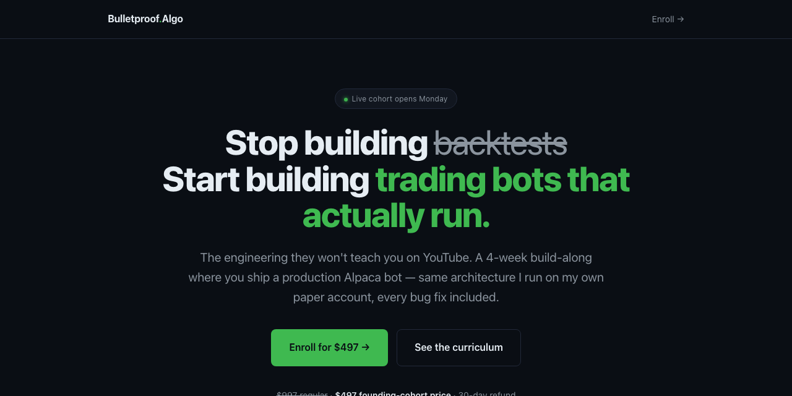

# Bulletproof.Algo

Landing page for **Bulletproof.Algo**, a four-week build-along course on shipping a production-grade Alpaca trading bot: the engineering nobody teaches on YouTube, from the same architecture the author runs on paper every day.

 

**Try it: https://suncal.github.io/bulletproof-algo/**

## What it does

- Static landing page, no build step
- Curriculum in `CURRICULUM.md`
- Not financial advice; the course teaches engineering, not signals

## Run it

Open `index.html`.

---

**If this is useful to you, a ⭐ on the repo helps other people find it.** Issues and pull requests are welcome.

Built by [Priyankar "Sunny" Chakraborty](https://github.com/suncal) · [everbuiltstudio.com](https://everbuiltstudio.com)
